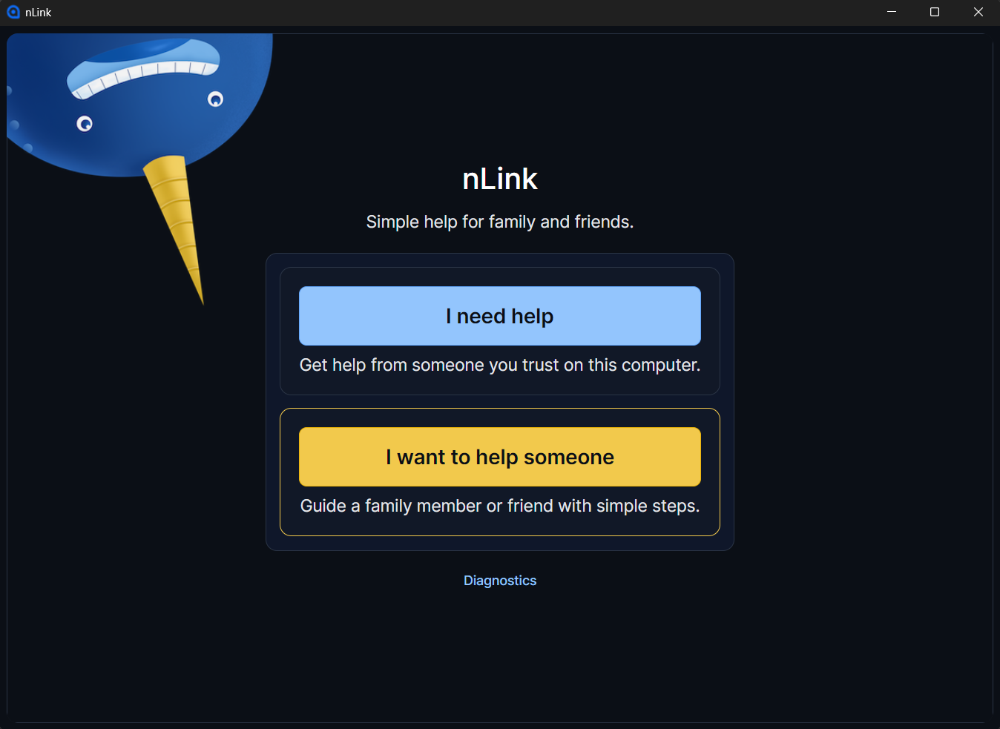
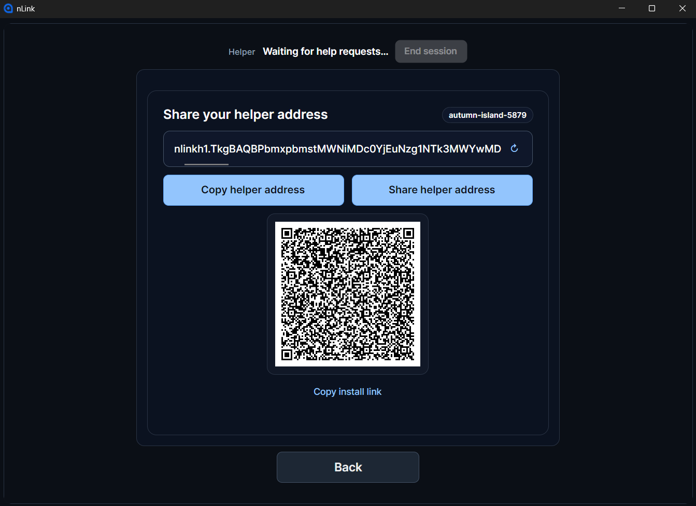
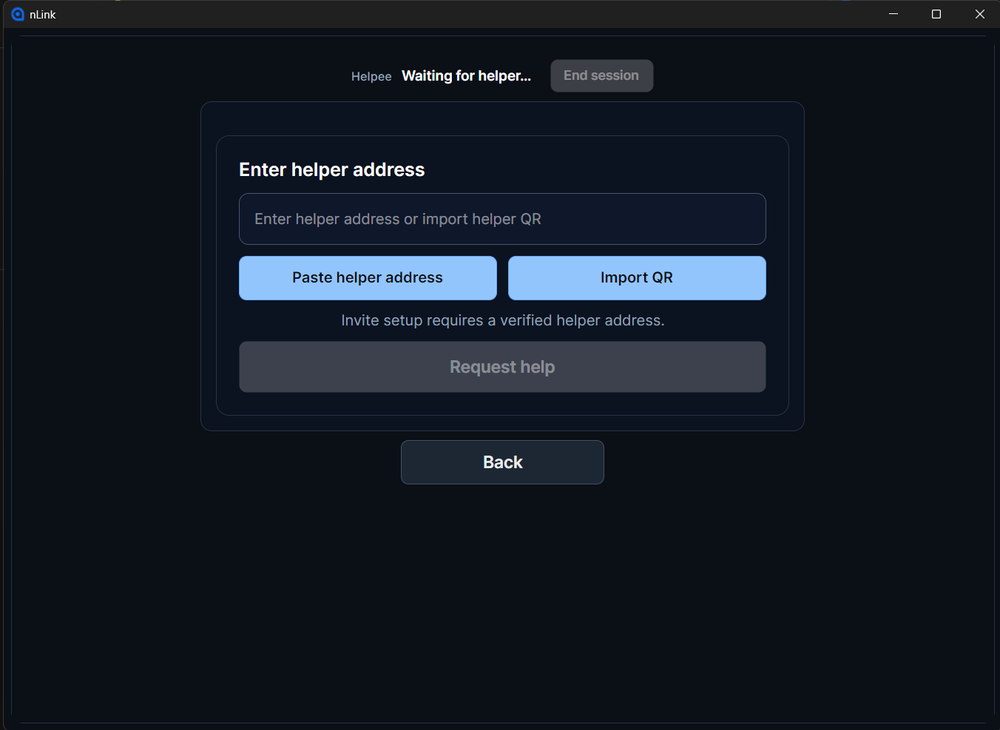
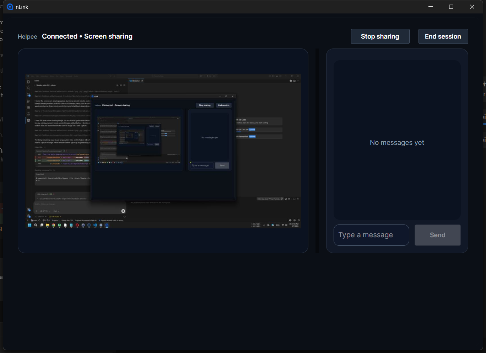
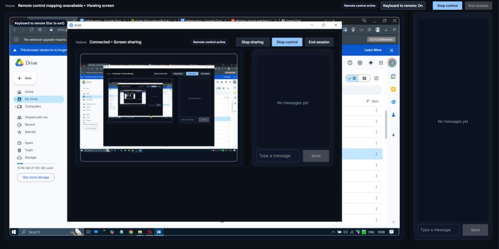

# nLink

nLink is a private, serverless Windows remote-help app for helping family and friends with chat, screen sharing, optional remote control, and single-file transfer. No accounts needed.

Created by Codex/GPT

Powered by NKN. Official website: https://nkn.org/

Minimal `.NET 8` / Avalonia desktop app for Windows with deterministic smoke tests.

## 0.7.0 Release Candidate

This branch prepares `0.7.0`; it is not a published release. It keeps H.264 screen sharing and regular NKN file transfer, and adds optional, default-off Tuna acceleration and wallet controls. The October 15 seven-scenario GUI gate passed strict file-transfer correctness on `cf8ea296`, including helper-to-helpee payer handoff. Authenticated-delivery proof and exact-payload installer upgrade/uninstall checks passed; separate performance FAIL/WARN results remain recorded. Final CI and release sign-off are still pending. See the [release notes](docs/releases/0.7.0.md) and [current candidate evidence](docs/ReleaseRunbook.md#current-qualification-update-2026-10-15).

## Quick Start (Windows)

1. Download the Installer (recommended) or Portable ZIP from [GitHub Releases](https://github.com/resu12/nLink/releases). A source-branch version is not necessarily a published release.
2. Helper opens nLink, clicks `I want to help`, and copies the helper address.
3. Helpee opens nLink, clicks `I need help`, enters the provided helper address, and clicks `Request help`.
4. Helper receives the incoming help request and clicks `Accept`.
5. Both sides compare the session verification symbols, then Helpee clicks `Allow`.
6. Chat opens on both sides.
7. If `Transfer files` is allowed for the session, either side can click `Send file`.

The screenshots below use a historical baseline: nLink 0.4.5; they are not current 0.7.0 UI captures.

Home:



Helper:



Helpee:



Screen sharing:



Remote control:



If connection fails:
Open Options -> Diagnostics -> Copy diagnostics and include it when reporting issues. If a screenshare soak artifact has already been analyzed, Options includes a compact screenshare evidence summary; for hangs or freezes, use Options -> Diagnostics -> Save Hang Report. See [`docs/supportability.md`](docs/supportability.md) for the support evidence checklist.

For release-safe builds, Options -> Diagnostics should show:

- `invite_security_mode: issued_one_time_secret_invites`
- `invite_public_flow: verified_helper_required`
- `invite_security_release_ready: Yes`
- `invite_security_warning: none`

Normal release UX uses a raw helper address and an approval-time session verification sequence, then a direct helpee-side `Request help` flow with QR/share/copy support where needed. The approval check is a compact five-symbol comparison on both screens.

Notes:

- Windows x64 only
- Default screensharing uses H.264 video transport, with helper-side recovery protection for broken reference chains.
- Options -> Settings includes Balanced, High quality, Tuna quality, and High performance screen-share presets. High quality now opts into 24 capture FPS / 15 transport FPS over normal NKN, while Tuna quality remains the higher-bandwidth preset recommended for Tuna-enabled screen sharing.
- The helper-side cursor overlay, H.264 motion/keyframe safeguards, WGC GPU scaling, and same-apartment Win10 WGC teardown remain enabled.
- Chat UX keeps `Enter` to send, `Shift+Enter` for a new line, stable pane sizing in chat-only and screen-sharing layouts, and message entry remains available during screen sharing.
- File transfer in `0.7.0` is single-file only. No folders, drag-and-drop, or resume after restart yet.
- Route defaults are explicit: regular NKN uses `regular_nkn_v4_fast` / protocol `4`, active file Tuna uses `file_tuna_v4` / protocol `4`, and controlled post-Tuna fallback uses `post_tuna_fallback_v6` / protocol `6` for the affected transfer. `diagnostic_regular_nkn_v6` is unsafe developer/test opt-in only; active `file_tuna_v6` is invalid.
- Receiving a file requires explicit accept/decline, and file-transfer data is protected by nLink's session envelope plus source/session validation rather than by assuming NKN transport alone is sufficient.
- The bundled NKN bridge/runtime remains a trust boundary; transport encryption does not replace nLink's application checks.
- Active file transfers can be paused, resumed, or canceled from either side when file transfer is allowed.
- File-transfer lifecycle actions are hard-priority: cancel, pause, session end, peer down, window close, and app exit do not wait for file-data queues, repair queues, Tuna, or bulk backlog.
- If Tuna stops during a Tuna V4 transfer, the same transfer live-transitions to V6 fallback over regular NKN. Explicit reactivation can return that transfer to Tuna V4. After successful final fallback completion, the next new transfer resolves from current transport state: Tuna V4 when active, otherwise regular V4.
- Progress is based on accepted/receiver-confirmed bytes, not merely queued sends. The bars smooth reported progress without predicting future delivery; network acknowledgements can still make the two displays differ briefly. Completion requires final SHA-256 verification.
- Received files are saved into the Windows Downloads folder by default, with a numbered suffix added automatically when the target name already exists.
- Safe-by-default file size cap for `0.7.0`: `25 GiB`
- Options -> Wallet exposes an experimental Tuna wallet-linking and runtime opt-in section; linking a wallet does not start Tuna, spend NKN, or change the default transport.
- Tuna startup status and a pulsing fish indicate an unlocked connection attempt, not proof of payload delivery. Gray is inactive, light blue is the non-paying side, and yellow identifies the selected paying listener. Linking or validating a wallet does not spend NKN; starting a paid listener can. See the [Tuna guide](docs/nkn-tuna-implementation.md).
- The strict Phase 5 release gate requires actual payload delivery, SHA integrity, coordinator-published routes, authenticated Tuna delivery, fallback, and terminal GUI completion. Performance is reported separately under the existing policy, without changing numeric baselines or promising Tuna/fallback throughput.
- Large file transfers over NKN can still be noticeably slower than local or direct network copy. Live screenshare latency can also vary with NKN/network delivery.
- Release exception: Windows artifacts for `0.7.0` are unsigned; verify downloads with `SHA256SUMS.txt`.
- Installer path: `%LOCALAPPDATA%\Programs\nLink`

License:

- MIT (see `LICENSE`)

## Documentation

- Current docs index:
  [`docs/README.md`](docs/README.md)
- Support evidence guide:
  [`docs/supportability.md`](docs/supportability.md)
- Test lane matrix:
  [`docs/test-lanes.md`](docs/test-lanes.md)
- Screenshare operator guide:
  [`docs/screenshare-operability.md`](docs/screenshare-operability.md)
- Screenshare implementation guide:
  [`docs/screenshare-implementation.md`](docs/screenshare-implementation.md)
- File transfer implementation guide:
  [`docs/file-transfer-implementation.md`](docs/file-transfer-implementation.md)
- File transfer and Tuna operator guide:
  [`docs/file-transfer-operability.md`](docs/file-transfer-operability.md)
- NKN Tuna implementation guide:
  [`docs/nkn-tuna-implementation.md`](docs/nkn-tuna-implementation.md)

## Build from source (developers)

### How to run

1. Restore dependencies:
   `dotnet restore`
2. Run the desktop app:
   `dotnet run --project src/nLink.App`

### How to build

1. Build the solution:
   `dotnet build`

### Tests

- During implementation, run focused tests for the changed behavior and its affected ownership lane. Reserve the full sweep for a planned broad regression gate:
  `powershell -ExecutionPolicy Bypass -File .\tools\Test-Lanes.ps1 -Lane Core,Gui,ScreenShare,RemoteControl,Contracts`
- Run deterministic release smoke tests:
  `powershell -ExecutionPolicy Bypass -File .\tools\Test-Lanes.ps1 -Lane Smoke -Configuration Release`
- See the lane matrix:
  [`docs/test-lanes.md`](docs/test-lanes.md)
- For screenshare validation and support flow selection:
  `powershell -ExecutionPolicy Bypass -File .\tools\ScreenShare-Ops.ps1 -Mode Test`
  [`docs/screenshare-operability.md`](docs/screenshare-operability.md)

### Release Validation (Maintainers, Windows)

- Planned final gate (tests, strict Phase 5 GUI route acceptance, and packaging):
  `powershell -ExecutionPolicy Bypass -File .\tools\PreRelease-Check.ps1 -RunGuiSmoke -RunBetaReadiness -RunFileTransferRouteAcceptanceGate`
- Live validation needs an interactive Windows desktop, a low-balance test wallet, and a session-only password. In sandboxed automation, run live NKN/GUI checks and preflights with explicit escalation; never bypass a failed preflight. See the [runbook](docs/ReleaseRunbook.md) for setup and evidence requirements.
- Omitting `-RunFileTransferRouteAcceptanceGate` skips that gate; packaging success alone is not route qualification.
- Output release assets:
  `artifacts/releases/<version>/nLink-Portable-win-x64-<version>.zip`
  `artifacts/releases/<version>/nLink-Setup-win-x64-<version>.exe`
- Final release notes:
  [`docs/releases/0.7.0.md`](docs/releases/0.7.0.md)
- GitHub release body:
  [`docs/releases/0.7.0-github.md`](docs/releases/0.7.0-github.md)
- RC/final validation checklist:
  [`docs/release/rc-validation-checklist.md`](docs/release/rc-validation-checklist.md)

### Dead-Code Report (Local, Non-Destructive)

- Generate a warning-based dead-code candidate report:
  `powershell -ExecutionPolicy Bypass -File .\tools\DeadCode-Report.ps1`
- Output:
  `artifacts/deadcode/report.md`

### Resource Footprint Tools

- Resource benchmark (idle/connect/idle/disconnect/idle, writes JSON + summary):
  `dotnet run --project src/nLink.App -c Release -- --resource-bench --transport devlocal`
- Leak check (cycle-based growth check, writes JSON + summary):
  `dotnet run --project src/nLink.App -c Release -- --leak-check --cycles 200 --transport devlocal`
- Enable resource gate failure (threshold + growth checks):
  add `--fail-on-gate`
- ResourceGate threshold overrides (examples):
  `--resource-growth-warn-percent 10 --resource-growth-fail-percent 20`
  `--app-working-set-max-mb 1024 --app-private-bytes-max-mb 1024 --app-thread-max 400 --app-handle-max 20000 --app-cpu-idle-avg-max-pct 40`
  `--bridge-working-set-max-mb 512 --bridge-private-bytes-max-mb 512 --bridge-thread-max 300 --bridge-handle-max 20000 --bridge-cpu-idle-avg-max-pct 40 --resource-fail-on-bridge-thresholds`
- LeakCheck growth threshold override:
  `--leak-growth-fail-percent 20`
- Pre-release helpers:
  `powershell -ExecutionPolicy Bypass -File .\tools\PreRelease-Check.ps1 -RunResources -RunLeakCheck`

### Building the Portable Package and Installer

Build prerequisites are the .NET 8 SDK and Go toolchain; installer creation also needs Inno Setup 6 (`ISCC.exe`). Bridge dependencies use the pinned, hash-verified Node bootstrap and locked npm restore. End users do not need .NET, Node, npm, or Go installed.

```powershell
# Portable app, bridge, Tuna sidecar, and ZIP:
powershell -ExecutionPolicy Bypass -File .\installer\Build-Portable.ps1 -Runtime win-x64

# Alternatively, build these plus the installer and release assets:
powershell -ExecutionPolicy Bypass -File .\installer\Build-Installer.ps1 -Runtime win-x64
```

Both scripts rebuild the canonical payload by default; a separate bridge build is not a prerequisite. `Build-Installer.ps1` calls `Build-Portable.ps1`, so running both consecutively rebuilds it twice. A new rebuild is not automatically covered by earlier exact-binary GUI evidence: retain source/contract applicability and payload hashes before release sign-off.

Outputs:

- Canonical portable folder: `artifacts/portable/nLink/win-x64`.
- Portable ZIP: `artifacts/portable/nLink-Portable-win-x64-<version>.zip`.
- Installer: `artifacts/installer/nLink-Setup-win-x64-<version>.exe`.
- Release assets and checksums: `artifacts/releases/<version>/` (unless `-LocalOnly`).

The ZIP contains a self-contained `nLink.exe` plus required bridge, Tuna, and media files; keep the folder together. Helper/helpee alias folders are optional (`-CopyHelperAlias` / `-CopyHelpeeAlias` on the portable builder), not separate products or default installer staging.

Without Inno Setup, the installer script leaves the portable output available but exits with a missing-compiler error. The installer is per-user (`%LOCALAPPDATA%\Programs\nLink`) and does not require admin elevation. For release qualification and signing policy, use the [release runbook](docs/ReleaseRunbook.md).

### Bundled NKN Bridge Runtime (No Node Install Needed on End User PC)

Canonical bridge bundle artifact (built by the portable builder):

- `artifacts/bridge/win-x64/node.exe`
- `artifacts/bridge/win-x64/index.js`
- `artifacts/bridge/win-x64/package.json`
- `artifacts/bridge/win-x64/package-lock.json`
- `artifacts/bridge/win-x64/bridge-manifest.json`
- `artifacts/bridge/win-x64/bridge-dependencies.json`

The bridge uses a clean `npm ci` restore (`npm ci --ignore-scripts --no-audit --no-fund`) against `tools/nkn-bridge/package-lock.json`, `ncc`, and a pinned, hash-verified Node runtime. There is no shipped `node_modules` tree. The manifest records the app version from `VERSION`; packaging rejects stale manifests. The bundle is copied into the canonical app output/install.

Bundled runtime location inside the app output/install (required Release layout):

- `bridge/win-x64/node.exe`
- `bridge/win-x64/index.js`
- `bridge/win-x64/package.json`
- `bridge/win-x64/package-lock.json`
- `bridge/win-x64/bridge-manifest.json`
- `bridge/win-x64/bridge-dependencies.json`

Runtime behavior:
- `Release` builds prefer the bundled bridge runtime (`bridge/<rid>/node(.exe)` + `bridge/<rid>/index.js`)
- `Debug` builds allow launching `node` from `PATH` for local development
- `installer/Build-BridgeBundle.ps1 -UseSystemNode` exists for local experiments only; release builds use the pinned, hash-verified bootstrap path

Advanced overrides (developer/test only):
- `NLINK_NKN_NODE_PATH`
- `NLINK_NKN_BRIDGE_PATH`

In `Release` builds, unsafe transport, bridge path, NKN topology/recovery, file-transfer tuning, unsafe media, and release-link environment/appsettings overrides are ignored unless `NLINK_UNSAFE_DEVELOPER_MODE=1` is set for that developer test process. Public release validation should use the bundled bridge/runtime and keep the operator shell free of unsafe override variables.

### Manual NKN Integration Test (Not CI)

Use this only as a manual two-instance sanity check, not as file-transfer release proof. Do not add deterministic CI tests that depend on real NKN connectivity. Rebuild the portable package first, use its bundled runtime, and run live checks outside a restricted sandbox with explicit escalation when applicable.

Setup:
1. (Optional) Set a seed RPC endpoint:
   `$env:NLINK_UNSAFE_DEVELOPER_MODE = "1"`
   `$env:NLINK_NKN_SEED_RPC = "<rpc-host:port>"`

Keep such overrides scoped to the deliberate developer test process, not the public release shell.

Run the test (same PC, two app instances):
1. Start the first app instance:
   `.\artifacts\portable\nLink\win-x64\nLink.exe`
2. Click `I want to help` and copy the helper address.
3. Start the second app instance from the same portable folder.
4. Click `I need help`, paste the helper address, and click `Request help`.
5. Accept the incoming request on the helper side.
6. Compare the session verification symbols on both screens, then click `Allow` on the helpee side.
7. Send chat messages both ways and confirm they appear on both sides.

If it fails (copy diagnostics):
1. In the app, open `Options`
2. Select `Diagnostics` and click `Copy diagnostics`
3. Include the copied text when reporting the issue
