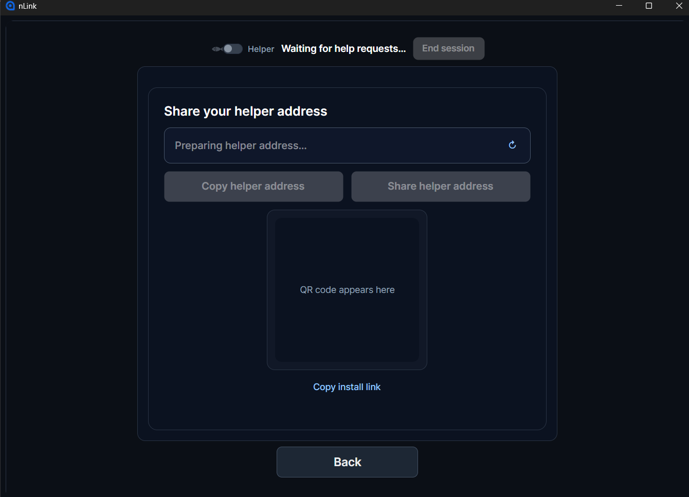

# nLink

nLink is a Windows x64 app for helping family and friends with chat, screen sharing, optional remote control, and single-file transfer. It uses [NKN](https://nkn.org/) and doesn't require an account.

## Download 0.7.1

- [Windows x64 installer (recommended)](https://github.com/resu12/nLink/releases/download/v0.7.1/nLink-Setup-win-x64-0.7.1.exe)
- [Windows x64 portable ZIP](https://github.com/resu12/nLink/releases/download/v0.7.1/nLink-Portable-win-x64-0.7.1.zip)
- [SHA256SUMS.txt](https://github.com/resu12/nLink/releases/download/v0.7.1/SHA256SUMS.txt)
- [0.7.1 release notes](https://github.com/resu12/nLink/releases/tag/v0.7.1)

The portable ZIP is self-contained. Extract it and keep its files together; you don't need to install .NET, Node.js, or Go to run it.

## What's new in 0.7.1

- Drop one file from Windows Explorer into chat or use **Send file**. The receiver can save to Downloads or choose a destination with **Save as…**.
- Enable Tuna during an approved session without reconnecting the help session. The header distinguishes a ready Tuna connection from a file using regular NKN.
- Refresh the session snapshot in Diagnostics independently of saved screen-share test results.

## Quick Start

1. On the Helper's PC, click **I want to help someone**. Wait for the verified helper address to be ready, then copy or share it.
2. On the Helpee's PC, click **I need help**, paste the address or import the Helper's QR code, and select **Request help**.
3. The Helper selects **Accept**. Compare the five verification symbols on both screens. If they match, the Helpee selects **Allow**.
4. Use chat or have the Helpee select **Share screen**. Remote control requires separate approval.

## Screenshots

### Home


### Helper preparing an address



### Helpee entering an address


### Screen sharing


### File transfer


See the [screenshot gallery notes](docs/images/README.md) for capture details.

## Usage notes

### Chat and screen sharing

- Press **Enter** to send a chat message or **Shift+Enter** for a new line.
- The Helpee chooses which display to share and can stop sharing without ending the session. A local preview doesn't prove the Helper is receiving the screen.
- Screen sharing uses H.264. Choose a screen-share preset in **Options → Settings**; use **Tuna quality** only when Tuna acceleration is enabled.

### File transfer

- When **Transfer files** is allowed, either person can select **Send file** or drop exactly one local file onto chat, not onto the shared screen. Each offer needs the receiver's approval.
- **Accept** saves to Downloads and adds a numbered suffix if the name is taken. **Save as…** lets the receiver choose a name and folder without overwriting an existing file. Canceling the picker leaves the offer pending.
- Use the transfer card to pause, resume, or cancel. The default size limit is 25 GiB. Folders, multi-file drops, and resume after restarting the app aren't supported.
- The two progress bars can differ briefly. A full bar isn't proof of completion; nLink verifies the file with SHA-256.

### Tuna

- Tuna is off by default. Linking or checking a wallet in **Options → Wallet** doesn't spend NKN. Starting a paid listener can; review its limits before unlocking.
- **Tuna is ready** means the session connection is confirmed. Read the tooltip to see if a file is still using regular NKN. The fish color alone doesn't prove file delivery.
- Switching Tuna off doesn't end the help session. Reconnecting Tuna doesn't resume user-paused files or automatically change their routes. See the [file transfer and Tuna guide](docs/file-transfer-operability.md).

### Troubleshooting

- On both PCs, open **Options → Diagnostics**, select **Refresh** under **Session snapshot**, then select **Copy diagnostics**. Review the output before sharing it.
- **Previous screen-share test run** is a saved result, not a verdict on the current session. For a freeze, use **Save Hang Report** while the app still responds.
- See [known issues](docs/KnownIssues.md), the [support guide](docs/supportability.md), and [screenshare evidence](docs/screenshare-operability.md).

## Build from source

Use the .NET 8 SDK on Windows:

```powershell
dotnet build
dotnet run --project src/nLink.App
```

To build a Windows x64 portable package, use the Go toolchain and `installer\Build-Portable.ps1`. For the installer, use `installer\Build-Installer.ps1` with Inno Setup 6. The packager bundles the regular NKN bridge and Tuna sidecar; end users don't install either separately.

Run focused checks with `tools\Test-Lanes.ps1`; see the [test lane matrix](docs/test-lanes.md). For screen-share diagnostics, use `tools\ScreenShare-Ops.ps1` and the [operator guide](docs/screenshare-operability.md). Packaging and release sign-off are covered by the [release runbook](docs/ReleaseRunbook.md) and [RC checklist](docs/release/rc-validation-checklist.md).

[Docs index](docs/README.md) · [Changelog](CHANGELOG.md) · [MIT license](LICENSE)

Created by Codex/GPT.
